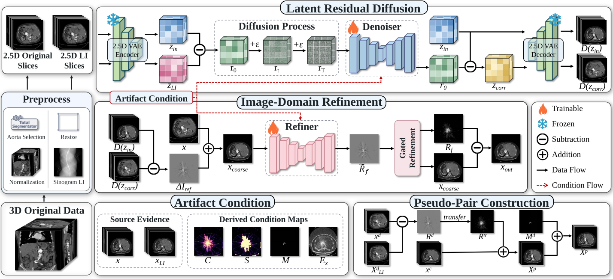
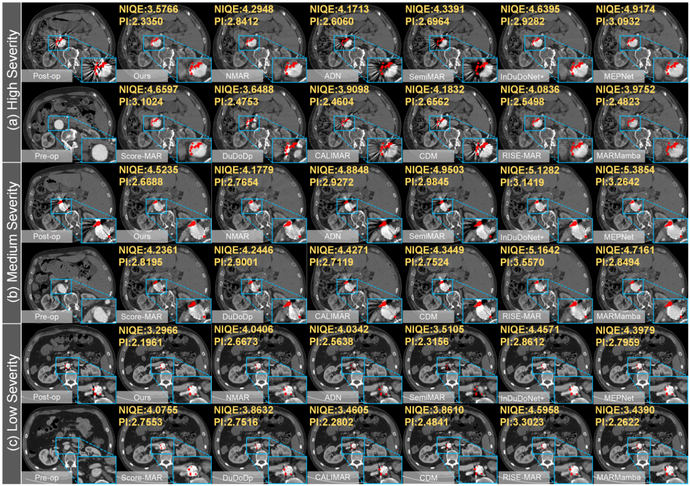
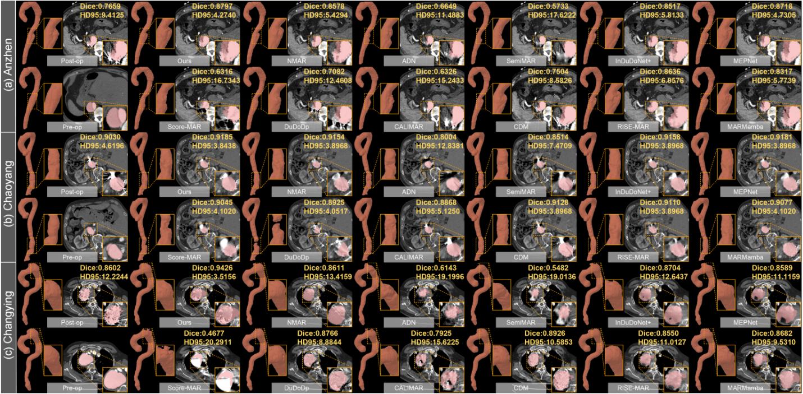
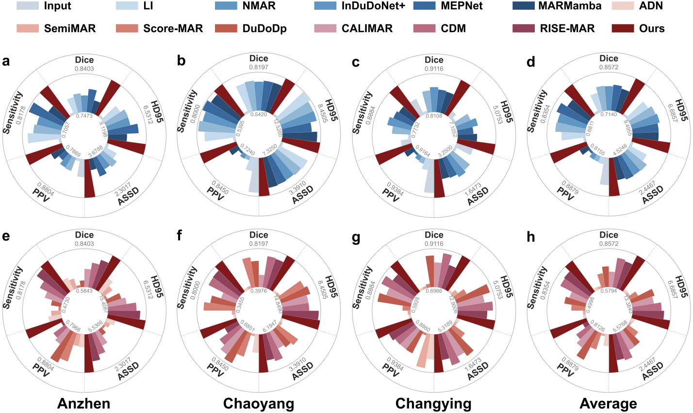
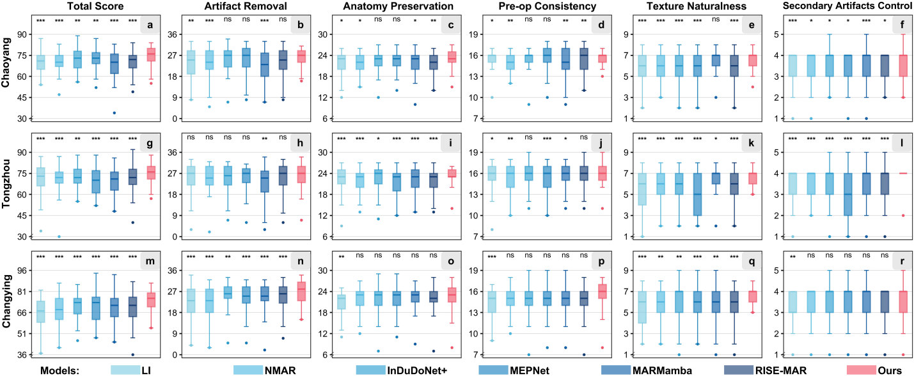
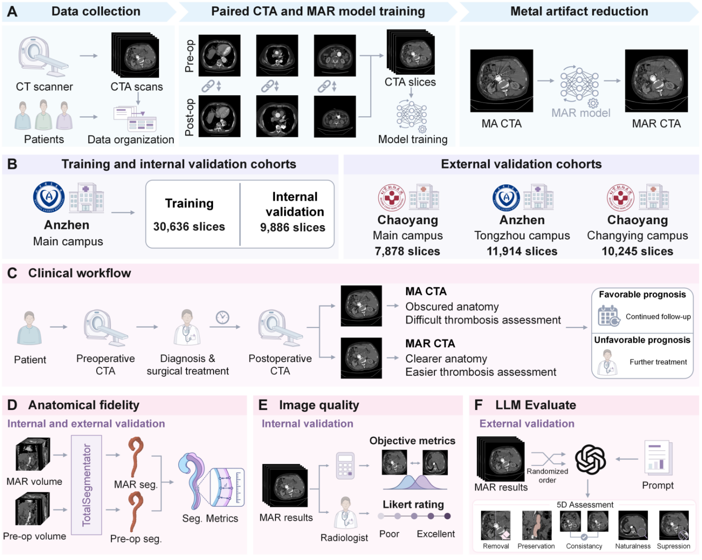

# 2SLRDM

**Artifact Transfer and Latent Residual Diffusion for Metal Artifact Reduction in Aortic CT Angiography**

[Method](#1-method-workflow) · [Code](#2-code-tree) · [Data](#3-datasets) · [Environment](#4-training-environment) · [Training](#5-training) · [Inference](#6-inference) · [Results](#7-experimental-results) · [Figures](#8-visualization-results) · [Citation](#9-citation)

## 1. Method Workflow

2SLRDM transfers clinical artifact residuals to construct pseudo-paired training data, then combines conditional latent diffusion with gated refinement at full image resolution.

[](imgs/figures/figure-02.png)

## 2. Code Tree

```text
2SLRDM/
├── configs/default.yaml
├── imgs/figures/
├── marldm/
│   └── models/
├── precompute_li.py
├── train_vae.py
├── train_refiner.py
├── infer.py
├── infer_nii.py
└── requirements.txt
```

## 3. Datasets

The study used aortic CTA acquired after coil embolization and available preoperative scans from four campuses of Beijing Anzhen Hospital and Beijing Chaoyang Hospital. The cohort comprised **34 patients, 78 CT examinations, and 70,559 axial slices**.

- **Training and internal testing (Anzhen Main Campus):** 15 patients, 37 exams, and 30,636 slices for training. The other 4 patients, 11 exams, and 9,886 slices were held out for internal testing.
- **External testing:** 15 patients, 30 exams, and 30,037 slices from Chaoyang Main (4 patients), Anzhen Tongzhou (6), and Chaoyang Changying (5).

All exams and slices from each patient stayed in one subset. The manuscript reports no separate validation cohort. For training runs, the code uses a seeded patient-level validation split (`data.val_fraction: 0.2`). Provide only training cases to that split and keep test patients separate.

## 4. Training Environment

Training and inference smoke tests used **Windows 11 25H2 (build 26200)**, **GeForce RTX 5080**, **Python 3.10.19**, **PyTorch 2.10.0.dev20251029+cu128**, **CUDA 12.8**, and **ASTRA Toolbox 2.4.1**. The tested environment also used NumPy 2.2.6, SciPy 1.13.1, scikit-image 0.25.2, and NiBabel 5.4.0.

Install a CUDA-enabled PyTorch build for your GPU, then install the dependencies.

```bash
python -m pip install -r requirements.txt
```

## 5. Training

Set `data.with_metal`, `data.without_metal`, and `data.li_root` in [configs/default.yaml](configs/default.yaml). Store axial HU slices as 2D NPY files in case folders. Each LI file mirrors its input's relative path.

| Setting | Default joint training |
| :--- | :--- |
| Input and Refiner size | 512 × 512, 3 adjacent slices |
| LDM working image size | 256 × 256 |
| Epochs, batch size, gradient accumulation | 100, 1, 8 |
| Learning rate | LDM `2e-5`, Refiner `1e-4` |
| Precision and seed | BF16, `2026` |

```bash
python precompute_li.py --config configs/default.yaml

python train_refiner.py --config configs/default.yaml \
  --vae-checkpoint checkpoints/vae_best.pt \
  --output checkpoints/near_metal_dark_v1_best.pt
```

The default run uses a compatible pretrained VAE. Resume with `--resume checkpoints/near_metal_dark_v1_last.pt`.

### Train a 512 × 512 VAE

```bash
python train_vae.py --config configs/default.yaml --epochs 50 --batch-size 1

python train_refiner.py --config configs/default.yaml --coarse-size 512 \
  --vae-checkpoint checkpoints/vae512_best.pt --output checkpoints/joint512_best.pt
```

## 6. Inference

Place a matching VAE and joint checkpoint at the paths below. Use `--coarse-size 512` for checkpoints trained with the 512 × 512 variant.

```bash
# One NPY slice
python infer.py --input data/slice.npy --output outputs/mar.npy --sample-steps 50 \
  --vae-checkpoint checkpoints/vae_best.pt --checkpoint checkpoints/near_metal_dark_v1_best.pt

# NPY directory
python infer.py --input data/with_metal --output outputs/mar --save-npy \
  --vae-checkpoint checkpoints/vae_best.pt --checkpoint checkpoints/near_metal_dark_v1_best.pt

# NIfTI volume
python infer_nii.py --input data/volume.nii.gz --output outputs/mar.nii.gz \
  --vae-checkpoint checkpoints/vae_best.pt --checkpoint checkpoints/near_metal_dark_v1_best.pt
```

## 7. Experimental Results

**Bold** and <ins>underlined</ins> indicate the best and second-best values as marked in the manuscript.

### Table 2. Image quality on 2,630 CT slices

Parentheses show changes from the original input.

| Methods | FID↓ | KID↓ | NIQE↓ | PI↓ | AI↓ |
| :--- | :---: | :---: | :---: | :---: | :---: |
| Input | 44.27 | 1.91 | 6.06 | 4.89 | 147.44 |
| <strong>Traditional methods</strong> |  |  |  |  |  |
| LI | 39.49 (−4.78) | 1.61 (−0.30) | 5.87 (−0.19) | 4.27 (−0.62) | 52.81 (−94.63) |
| NMAR | 35.77 (−8.50) | 1.13 (−0.78) | 5.81 (−0.25) | 4.03 (−0.86) | 48.40 (−99.04) |
| <strong>Supervised Methods</strong> |  |  |  |  |  |
| InDuDoNet+ | 32.81 (−11.46) | 0.87 (−1.04) | 5.43 (−0.63) | 3.94 (−0.95) | <ins>42.62</ins> (−104.83) |
| MEPNet | 33.06 (−11.21) | 0.92 (−0.99) | 5.66 (−0.40) | 4.00 (−0.89) | 44.79 (−102.65) |
| MARMamba | 32.70 (−11.57) | 0.85 (−1.06) | 5.33 (−0.73) | 3.91 (−0.98) | 56.35 (−91.09) |
| <strong>Unsupervised Methods</strong> |  |  |  |  |  |
| ADN | 33.11 (−11.16) | 0.87 (−1.04) | 5.76 (−0.30) | 3.91 (−0.98) | 115.00 (−32.44) |
| SemiMAR | 32.86 (−11.41) | 0.85 (−1.06) | 5.72 (−0.34) | 3.90 (−0.99) | 110.48 (−36.97) |
| Score-MAR | 34.68 (−9.59) | 1.18 (−0.73) | 5.44 (−0.62) | 3.89 (−1.00) | 67.66 (−79.78) |
| DuDoDp | 33.21 (−11.06) | 0.92 (−0.99) | 5.31 (−0.75) | 3.92 (−0.97) | 72.83 (−74.62) |
| CALIMAR | 34.38 (−9.89) | 0.95 (−0.96) | 5.60 (−0.46) | <ins>3.83</ins> (−1.06) | 76.28 (−71.16) |
| CDM | <ins>32.56</ins> (−11.71) | <ins>0.84</ins> (−1.07) | <ins>5.30</ins> (−0.76) | 3.94 (−0.95) | 95.17 (−52.27) |
| RISE-MAR | 34.16 (−10.11) | 1.03 (−0.88) | 5.74 (−0.32) | 3.92 (−0.97) | 45.62 (−101.82) |
| <strong>Ours</strong> | <strong>32.28</strong> (−11.99) | <strong>0.78</strong> (−1.13) | <strong>5.24</strong> (−0.82) | <strong>3.81</strong> (−1.08) | <strong>39.66</strong> (−107.78) |

<details>
<summary><strong>Table 3. Radiologist ratings</strong></summary>

Mean ± SD [95% CI] for 200 slices. P-values are from paired Wilcoxon tests with Holm correction.

| Method | Radiologist 1 | p-value | Radiologist 2 | p-value | Radiologist 3 | P-value |
| :--- | :---: | :---: | :---: | :---: | :---: | :---: |
| InDuDoNet+ | 3.65±0.70[3.56,3.75] | 3.16×10<sup>−18</sup> | 3.19±0.94[3.06,3.32] | 0.0463 | 3.95±0.42[3.89,4.00] | 2.91×10<sup>−11</sup> |
| MEPNet | 3.88±0.59[3.80,3.96] | 1.23×10<sup>−6</sup> | <ins>3.21±0.89[3.09,3.34]</ins> | 0.1458 | <ins>4.17±0.37[4.12,4.22]</ins> | 0.7539 |
| MARMamba | <ins>3.94±0.52[3.86,4.01]</ins> | 1.72×10<sup>−5</sup> | 3.03±0.94[2.90,3.16] | 1.50×10<sup>−8</sup> | 3.89±0.34[3.84,3.93] | 5.12×10<sup>−13</sup> |
| ADN | 3.28±0.76[3.18,3.39] | 2.55×10<sup>−27</sup> | 2.73±1.03[2.58,2.87] | 2.90×10<sup>−11</sup> | 3.11±0.63[3.02,3.20] | 3.02×10<sup>−40</sup> |
| SemiMAR | 3.32±0.80[3.21,3.43] | 1.91×10<sup>−29</sup> | 2.75±1.12[2.60,2.91] | 6.30×10<sup>−15</sup> | 3.62±0.58[3.54,3.70] | 9.26×10<sup>−23</sup> |
| Score-MAR | 3.02± 0.63[2.93,3.11] | 1.07×10<sup>−46</sup> | 2.41±0.81[2.30,2.52] | 1.39×10<sup>−29</sup> | 3.46±0.70[3.36,3.55] | 2.34×10<sup>−26</sup> |
| DuDoDp | 3.21± 0.63[3.12,3.29] | 1.09×10<sup>−40</sup> | 2.83±0.88[2.71,2.95] | 7.98×10<sup>−8</sup> | 3.54±0.51[3.47,3.61] | 5.08×10<sup>−32</sup> |
| CALIMAR | 3.73±0.66[3.64,3.82] | 5.69×10<sup>−9</sup> | 3.02±1.12[2.87,3.18] | 0.0021 | 3.69±0.57[3.61,3.77] | 1.80×10<sup>−15</sup> |
| RISE-MAR | 3.70±0.70[3.60,3.79] | 1.80×10<sup>−15</sup> | 3.14±1.01[3.00,3.28] | 0.0135 | 3.93±0.26[3.89,3.97] | 2.70×10<sup>−13</sup> |
| CDM | 3.87±0.73[3.77,3.97] | 0.0091 | 3.06±1.09[2.91,3.21] | 0.0021 | 3.84±0.38[3.79,3.89] | 3.33×10<sup>−16</sup> |
| <strong>Ours</strong> | <strong>4.04±0.46[3.97,4.10]</strong> | — | <strong>3.30±0.90[3.17,3.42]</strong> | — | <strong>4.18±0.38[4.13,4.23]</strong> | — |

</details>

<details>
<summary><strong>Table 4. Agreement with preoperative aortic segmentation</strong></summary>

Mean ± SD across 4 Anzhen Main, 4 Chaoyang Main, and 5 Chaoyang Changying CT volumes.

#### Anzhen Hospital Main Campus

| Method | Dice ↑ | HD95 ↓ | ASSD ↓ | PPV ↑ | Sensitivity ↑ |
| :--- | :---: | :---: | :---: | :---: | :---: |
| Input | 0.7526 ± 0.1306 | 8.9732 ± 4.0830 | 3.6008 ± 1.5902 | 0.8309 ± 0.1438 | 0.7121 ± 0.1715 |
| LI | 0.7871 ± 0.1460 | 7.8130 ± 3.9853 | 3.2115 ± 1.8487 | 0.7941 ± 0.1555 | 0.8023 ± 0.1746 |
| NMAR | 0.7930 ± 0.1358 | 7.4990 ± 3.5932 | 3.0385 ± 1.6248 | 0.8222 ± 0.1411 | 0.7861 ± 0.1723 |
| InDuDoNet+ | 0.7874 ± 0.1368 | 7.5331 ± 3.6398 | 3.1263 ± 1.6381 | 0.8208 ± 0.1509 | 0.7794 ± 0.1744 |
| MEPNet | <ins>0.8036 ± 0.1312</ins> | <ins>7.0504 ± 3.0007</ins> | <ins>2.9646 ± 1.5896</ins> | 0.8102 ± 0.1509 | <ins>0.8134 ± 0.1541</ins> |
| MARMamba | 0.7786 ± 0.1384 | 7.8426 ± 3.7991 | 3.2732 ± 1.6846 | 0.8228 ± 0.1480 | 0.7628 ± 0.1794 |
| ADN | 0.6734 ± 0.1118 | 11.5708 ± 3.4347 | 4.7713 ± 1.3815 | 0.8247 ± 0.1460 | 0.5888 ± 0.1243 |
| SemiMAR | 0.6517 ± 0.1090 | 12.8425 ± 3.7314 | 5.0902 ± 1.3656 | 0.8233 ± 0.1481 | 0.5586 ± 0.1242 |
| Score-MAR | 0.5988 ± 0.1399 | 14.9043 ± 4.0094 | 5.3534 ± 1.4066 | 0.8618 ± 0.0992 | 0.4926 ± 0.1860 |
| DuDoDP | 0.6274 ± 0.2380 | 11.8988 ± 4.0345 | 4.9669 ± 2.5867 | <ins>0.8723 ± 0.0932</ins> | 0.5636 ± 0.2842 |
| CALIMAR | 0.7049 ± 0.1243 | 10.9912 ± 3.8834 | 4.2252 ± 1.5076 | 0.8351 ± 0.1360 | 0.6349 ± 0.1665 |
| RISE-MAR | 0.7830 ± 0.1470 | 7.9489 ± 4.3926 | 3.2032 ± 1.8306 | 0.8014 ± 0.1372 | 0.7906 ± 0.1917 |
| CDM | 0.7502 ± 0.1341 | 8.8244 ± 4.2820 | 3.6384 ± 1.6914 | 0.8284 ± 0.1440 | 0.7099 ± 0.1747 |
| <strong>Ours</strong> | <strong>0.8403 ± 0.1237</strong> | <strong>6.5312 ± 3.2694</strong> | <strong>2.3017 ± 1.5223</strong> | <strong>0.8804 ± 0.1063</strong> | <strong>0.8178 ± 0.1684</strong> |

#### Chaoyang Hospital Main Campus

| Method | Dice ↑ | HD95 ↓ | ASSD ↓ | PPV ↑ | Sensitivity ↑ |
| :--- | :---: | :---: | :---: | :---: | :---: |
| Input | 0.5578 ± 0.3395 | 12.2957 ± 8.3934 | 7.1023 ± 6.4080 | <ins>0.8339 ± 0.1606</ins> | 0.5543 ± 0.3633 |
| LI | 0.7523 ± 0.1140 | <ins>8.5075 ± 4.3193</ins> | 4.0513 ± 2.1391 | 0.7672 ± 0.1324 | 0.7474 ± 0.1182 |
| NMAR | <ins>0.7599 ± 0.1172</ins> | 8.7515 ± 5.0323 | 4.1693 ± 2.4474 | 0.7369 ± 0.1359 | 0.7912 ± 0.1077 |
| InDuDoNet+ | 0.7509 ± 0.1230 | 8.7192 ± 4.9404 | 4.2861 ± 2.5807 | 0.7391 ± 0.1344 | 0.7704 ± 0.1249 |
| MEPNet | 0.7593 ± 0.1200 | 9.4025 ± 5.7131 | 4.2275 ± 2.5726 | 0.7309 ± 0.1385 | <ins>0.7962 ± 0.1082</ins> |
| MARMamba | 0.7583 ± 0.1142 | 8.8278 ± 5.1936 | 4.1634 ± 2.5390 | 0.7555 ± 0.1291 | 0.7692 ± 0.1160 |
| ADN | 0.4215 ± 0.3353 | 14.4868 ± 7.4526 | 6.0360 ± 5.0689 | 0.7619 ± 0.1736 | 0.3713 ± 0.3196 |
| SemiMAR | 0.4248 ± 0.3488 | 14.4508 ± 10.4027 | 5.9975 ± 6.0923 | 0.6942 ± 0.2372 | 0.3837 ± 0.3391 |
| Score-MAR | 0.7320 ± 0.0802 | 10.2764 ± 3.6726 | 4.3710 ± 1.6079 | 0.7879 ± 0.1565 | 0.7195 ± 0.1207 |
| DuDoDP | 0.6851 ± 0.1815 | 9.7526 ± 5.2088 | 4.6104 ± 2.7209 | 0.8324 ± 0.1562 | 0.6465 ± 0.2395 |
| CALIMAR | 0.5313 ± 0.3668 | 10.4058 ± 8.5217 | 4.8204 ± 4.7506 | 0.8126 ± 0.1614 | 0.5348 ± 0.3818 |
| RISE-MAR | 0.7365 ± 0.1388 | 8.7880 ± 4.7495 | 4.2417 ± 2.4028 | 0.7458 ± 0.1452 | 0.7384 ± 0.1527 |
| CDM | 0.7444 ± 0.1247 | 10.4011 ± 7.3446 | <ins>4.0452 ± 2.3606</ins> | 0.7887 ± 0.1478 | 0.7337 ± 0.1631 |
| <strong>Ours</strong> | <strong>0.8197 ± 0.0913</strong> | <strong>8.4505 ± 4.9467</strong> | <strong>3.3910 ± 2.1251</strong> | <strong>0.8450 ± 0.0919</strong> | <strong>0.8000 ± 0.1047</strong> |

#### Chaoyang Hospital Changying Campus

| Method | Dice ↑ | HD95 ↓ | ASSD ↓ | PPV ↑ | Sensitivity ↑ |
| :--- | :---: | :---: | :---: | :---: | :---: |
| Input | 0.8560 ± 0.1013 | 6.7402 ± 3.5861 | 2.5176 ± 1.2682 | <ins>0.9357 ± 0.0410</ins> | 0.8032 ± 0.1389 |
| LI | 0.8166 ± 0.2263 | 6.9903 ± 7.4228 | 3.1592 ± 4.9359 | 0.9229 ± 0.0938 | 0.7798 ± 0.2354 |
| NMAR | 0.8679 ± 0.1003 | 6.2570 ± 3.4220 | 2.3203 ± 1.0483 | 0.9200 ± 0.0598 | 0.8287 ± 0.1224 |
| InDuDoNet+ | 0.8763 ± 0.0893 | 5.9752 ± 3.2347 | 2.2212 ± 1.0149 | 0.9194 ± 0.0460 | 0.8465 ± 0.1196 |
| MEPNet | 0.8704 ± 0.0901 | 6.2716 ± 3.8058 | 2.3583 ± 1.3182 | 0.9177 ± 0.0590 | 0.8356 ± 0.1226 |
| MARMamba | 0.8686 ± 0.0926 | 6.0793 ± 3.2681 | 2.4007 ± 1.2947 | 0.9222 ± 0.0540 | 0.8290 ± 0.1199 |
| ADN | 0.7088 ± 0.2077 | 12.4576 ± 6.9051 | 5.0159 ± 3.1161 | 0.9203 ± 0.1188 | 0.6096 ± 0.2242 |
| SemiMAR | 0.7091 ± 0.2370 | 11.7210 ± 7.4246 | 5.1110 ± 4.3872 | 0.9332 ± 0.0953 | 0.6142 ± 0.2359 |
| Score-MAR | 0.7166 ± 0.2408 | 10.2699 ± 5.5140 | 3.9299 ± 2.3429 | 0.8890 ± 0.0629 | 0.6534 ± 0.2698 |
| DuDoDP | 0.8732 ± 0.1236 | 5.7256 ± 3.9975 | 2.2112 ± 1.3909 | 0.9191 ± 0.0415 | 0.8523 ± 0.1499 |
| CALIMAR | 0.8346 ± 0.1940 | 7.2973 ± 5.4176 | 2.6486 ± 1.9965 | 0.9189 ± 0.0897 | 0.7981 ± 0.2142 |
| RISE-MAR | 0.8333 ± 0.2002 | 6.8500 ± 5.2481 | 2.8028 ± 2.8778 | 0.9230 ± 0.0468 | 0.8055 ± 0.2175 |
| CDM | <ins>0.8902 ± 0.0658</ins> | <ins>5.6933 ± 3.6540</ins> | <ins>2.0710 ± 1.0641</ins> | 0.9195 ± 0.0442 | <ins>0.8677 ± 0.0945</ins> |
| <strong>Ours</strong> | <strong>0.9116 ± 0.0331</strong> | <strong>5.0753 ± 1.9415</strong> | <strong>1.6473 ± 0.4715</strong> | <strong>0.9384 ± 0.0310</strong> | <strong>0.8884 ± 0.0561</strong> |

</details>

<details>
<summary><strong>Table 5. Exploratory LLM-assisted image quality scores</strong></summary>

Mean ± SD for 200 slices per cohort.

#### Chaoyang Hospital Main Campus

| Method | Total | Artifact Rem. | Anatomy Pre. | Pre-op Con. | Texture Nat. | Artifact Con. |
| :--- | :---: | :---: | :---: | :---: | :---: | :---: |
| Input | 40.48 ± 3.75 | 0.00 ± 0.00 | 20.60 ± 2.28 | 14.06 ± 1.09 | 5.82 ± 1.76 | 0.00 ± 0.00 |
| LI | 70.08 ± 6.94 | 23.71 ± 6.72 | 22.02 ± 3.04 | 15.29 ± 1.60 | 5.74 ± 1.53 | 3.33 ± 0.83 |
| NMAR | 69.79 ± 7.22 | 23.08 ± 7.23 | 22.05 ± 2.66 | 15.34 ± 1.27 | 5.82 ± 1.50 | 3.51 ± 0.73 |
| InDuDoNet+ | 71.93 ± 7.93 | 24.94 ± 6.30 | 22.22 ± 3.11 | 15.51 ± 1.65 | 5.76 ± 1.54 | 3.51 ± 0.69 |
| MEPNet | <ins>72.16 ± 7.40</ins> | <ins>25.20 ± 6.58</ins> | 22.20 ± 2.84 | <ins>15.54 ± 1.56</ins> | 5.69 ± 1.42 | 3.53 ± 0.69 |
| MARMamba | 68.61 ± 9.59 | 21.97 ± 6.84 | 21.82 ± 4.07 | 15.16 ± 2.12 | 6.31 ± 1.29 | 3.36 ± 0.91 |
| ADN | 60.97 ± 12.32 | 16.11 ± 10.85 | 21.02 ± 3.84 | 14.46 ± 2.08 | 6.00 ± 1.50 | 3.38 ± 0.96 |
| SemiMAR | 59.88 ± 11.38 | 16.52 ± 10.01 | 20.34 ± 4.33 | 14.12 ± 2.20 | 5.72 ± 1.67 | 3.17 ± 1.07 |
| Score-MAR | 54.26 ± 11.95 | 23.88 ± 6.89 | 14.46 ± 5.14 | 11.37 ± 3.17 | 2.94 ± 1.65 | 1.62 ± 1.00 |
| DuDoDP | 67.92 ± 10.23 | 21.82 ± 7.63 | 21.95 ± 3.06 | 15.11 ± 1.77 | 5.82 ± 1.37 | 3.23 ± 1.00 |
| CALIMAR | 62.18 ± 10.18 | 16.83 ± 9.56 | 21.29 ± 3.27 | 14.60 ± 1.78 | 6.11 ± 1.38 | 3.35 ± 0.93 |
| RISE-MAR | 70.58 ± 7.06 | 24.48 ± 6.19 | 21.76 ± 3.14 | 15.22 ± 1.71 | 5.63 ± 1.60 | 3.51 ± 0.69 |
| CDM | 64.54 ± 9.87 | 17.25 ± 9.01 | <ins>22.26 ± 3.42</ins> | 15.11 ± 1.80 | <ins>6.35 ± 1.42</ins> | <ins>3.57 ± 0.79</ins> |
| <strong>Ours</strong> | <strong>74.76 ± 5.86</strong> | <strong>25.83 ± 3.98</strong> | <strong>22.86 ± 2.61</strong> | <strong>15.76 ± 1.12</strong> | <strong>6.60 ± 0.84</strong> | <strong>3.71 ± 0.58</strong> |

#### Anzhen Hospital Tongzhou Campus

| Method | Total | Artifact Rem. | Anatomy Pre. | Pre-op Con. | Texture Nat. | Artifact Con. |
| :--- | :---: | :---: | :---: | :---: | :---: | :---: |
| Input | 40.73 ± 3.52 | 0.00 ± 0.00 | 20.82 ± 2.48 | 14.29 ± 0.99 | 5.62 ± 1.49 | 0.00 ± 0.00 |
| LI | 71.38 ± 9.96 | <ins>24.96 ± 6.71</ins> | 21.91 ± 4.01 | 15.52 ± 2.16 | 5.64 ± 1.81 | 3.37 ± 0.97 |
| NMAR | 70.45 ± 9.97 | 23.68 ± 7.47 | 22.12 ± 2.95 | 15.50 ± 1.73 | 5.74 ± 1.48 | 3.41 ± 0.80 |
| InDuDoNet+ | <ins>72.11 ± 7.93</ins> | 24.87 ± 5.98 | <ins>22.34 ± 3.46</ins> | <ins>15.74 ± 1.79</ins> | 5.76 ± 1.79 | 3.41 ± 0.91 |
| MEPNet | 69.33 ± 8.75 | 24.59 ± 6.40 | 21.21 ± 4.02 | 15.15 ± 2.12 | 5.26 ± 1.88 | 3.12 ± 1.07 |
| MARMamba | 69.92 ± 9.25 | 22.56 ± 8.01 | 22.13 ± 3.23 | 15.56 ± 1.66 | 6.33 ± 1.28 | 3.35 ± 0.88 |
| ADN | 58.71 ± 12.24 | 12.38 ± 9.64 | 21.55 ± 3.05 | 14.77 ± 1.55 | 6.38 ± 1.24 | 3.64 ± 0.72 |
| SemiMAR | 59.32 ± 13.52 | 13.68 ± 10.25 | 21.33 ± 3.82 | 14.65 ± 2.17 | 6.08 ± 1.50 | 3.58 ± 0.80 |
| Score-MAR | 56.41 ± 14.49 | 24.41 ± 9.85 | 15.20 ± 5.71 | 11.61 ± 3.35 | 3.52 ± 2.08 | 1.68 ± 1.33 |
| DuDoDP | 61.36 ± 10.25 | 21.27 ± 8.38 | 19.02 ± 4.44 | 13.74 ± 2.61 | 4.76 ± 1.82 | 2.58 ± 1.22 |
| CALIMAR | 60.74 ± 12.75 | 13.73 ± 9.76 | 21.97 ± 2.72 | 15.09 ± 1.60 | 6.35 ± 1.17 | 3.61 ± 0.76 |
| RISE-MAR | 71.74 ± 9.07 | 24.93 ± 6.61 | 22.12 ± 3.20 | 15.64 ± 1.72 | 5.64 ± 1.52 | 3.43 ± 0.82 |
| CDM | 59.52 ± 10.41 | 12.03 ± 8.42 | 22.20 ± 2.54 | 15.08 ± 1.43 | <ins>6.55 ± 1.17</ins> | <ins>3.67 ± 0.66</ins> |
| <strong>Ours</strong> | <strong>75.05 ± 7.11</strong> | <strong>25.32 ± 6.43</strong> | <strong>23.26 ± 2.09</strong> | <strong>16.05 ± 1.30</strong> | <strong>6.67 ± 0.83</strong> | <strong>3.76 ± 0.58</strong> |

#### Chaoyang Hospital Changying Campus

| Method | Total | Artifact Rem. | Anatomy Pre. | Pre-op Con. | Texture Nat. | Artifact Con. |
| :--- | :---: | :---: | :---: | :---: | :---: | :---: |
| Input | 39.20 ± 4.01 | 0.00 ± 0.00 | 19.92 ± 2.38 | 13.30 ± 1.20 | 5.97 ± 1.58 | 0.00 ± 0.00 |
| LI | 65.95 ± 9.11 | 21.97 ± 7.17 | 20.94 ± 3.64 | 14.31 ± 1.95 | 5.52 ± 1.64 | 3.23 ± 0.78 |
| NMAR | 67.85 ± 10.03 | 21.47 ± 7.59 | <ins>21.99 ± 3.07</ins> | <ins>14.97 ± 1.70</ins> | <ins>6.00 ± 1.41</ins> | 3.43 ± 0.79 |
| InDuDoNet+ | <ins>70.94 ± 9.23</ins> | <ins>24.84 ± 5.85</ins> | 21.76 ± 4.09 | 14.96 ± 2.08 | 5.91 ± 1.80 | 3.49 ± 0.79 |
| MEPNet | 70.38 ± 9.44 | 24.23 ± 6.31 | 21.82 ± 3.87 | 14.97 ± 2.12 | 5.88 ± 1.67 | <ins>3.49 ± 0.73</ins> |
| MARMamba | 70.31 ± 9.89 | 24.12 ± 6.86 | 21.88 ± 4.22 | 14.96 ± 2.29 | 5.91 ± 1.91 | 3.44 ± 0.84 |
| ADN | 67.33 ± 12.25 | 21.58 ± 8.37 | 21.64 ± 4.22 | 14.73 ± 2.24 | 5.98 ± 1.83 | 3.41 ± 1.01 |
| SemiMAR | 68.52 ± 9.38 | 23.05 ± 7.61 | 21.53 ± 4.04 | 14.71 ± 2.13 | 5.82 ± 1.69 | 3.41 ± 0.78 |
| Score-MAR | 53.65 ± 12.23 | 24.35 ± 6.02 | 14.06 ± 5.12 | 10.83 ± 2.81 | 2.89 ± 1.78 | 1.52 ± 1.10 |
| DuDoDP | 60.83 ± 14.01 | 20.65 ± 8.99 | 19.26 ± 4.46 | 13.41 ± 2.46 | 4.79 ± 1.81 | 2.73 ± 1.07 |
| CALIMAR | 62.59 ± 11.94 | 20.80 ± 8.22 | 20.03 ± 3.62 | 13.92 ± 2.01 | 5.00 ± 1.89 | 2.83 ± 1.06 |
| RISE-MAR | 69.56 ± 10.09 | 24.31 ± 6.23 | 21.47 ± 4.33 | 14.73 ± 2.32 | 5.67 ± 1.80 | 3.40 ± 0.87 |
| CDM | 67.48 ± 10.82 | 22.02 ± 7.42 | 21.58 ± 4.53 | 14.71 ± 2.31 | 5.88 ± 1.77 | 3.30 ± 0.99 |
| <strong>Ours</strong> | <strong>74.51 ± 7.27</strong> | <strong>26.90 ± 4.58</strong> | <strong>22.34 ± 3.83</strong> | <strong>15.28 ± 2.00</strong> | <strong>6.49 ± 0.95</strong> | <strong>3.52 ± 0.86</strong> |

</details>

<details>
<summary><strong>Table 6. Component ablation</strong></summary>

✓ and × denote enabled and disabled components. Parentheses show changes from the baseline.

| Artifact<br>Condition | Gated<br>Refinement | Refiner | FID↓ | KID↓ | NIQE↓ | PI↓ | AI↓ |
| :--- | :---: | :---: | :---: | :---: | :---: | :---: | :---: |
| × | × | × | 33.4936 | 0.8209 | 5.2714 | 3.8603 | 82.2338 |
| ✓ | × | × | 33.0881 (−0.4055) | 0.8179 (−0.0030) | 5.2674 (−0.0040) | 3.8569 (−0.0034) | 81.7255 (−0.5083) |
| × | × | ✓ | 32.6733 (−0.8203) | 0.8088 (−0.0121) | 5.2681 (−0.0033) | 3.8273 (−0.0330) | 72.1551 (−10.0787) |
| × | ✓ | ✓ | 32.5051 (−0.9885) | 0.8013 (−0.0196) | 5.2698 (−0.0016) | <ins>3.8224</ins> (−0.0379) | <ins>55.0214</ins> (−27.2123) |
| ✓ | × | ✓ | <ins>32.4080</ins> (−1.0856) | <ins>0.8005</ins> (−0.0204) | <ins>5.2571</ins> (−0.0143) | 3.8248 (−0.0355) | 69.7165 (−12.5173) |
| ✓ | ✓ | ✓ | <strong>32.2802</strong> (−1.2134) | <strong>0.7837</strong> (−0.0372) | <strong>5.2430</strong> (−0.0284) | <strong>3.8147</strong> (−0.0456) | <strong>39.6633</strong> (−42.5705) |

</details>

## 8. Visualization Results

### Figure 3. Artifact reduction across severity levels

[](imgs/figures/figure-03.png)

### Figure 4. Aortic segmentation and 3D reconstruction

[](imgs/figures/figure-04.png)

### Figure 5. Segmentation metrics across cohorts

[](imgs/figures/figure-05.png)

### Figure 6. Exploratory LLM-assisted score distributions

[](imgs/figures/figure-06.png)

<details>
<summary><strong>Figure 1. Study design and evaluation workflow</strong></summary>

[](imgs/figures/figure-01.png)

</details>

## 9. Citation

Citation details will be added when available.
