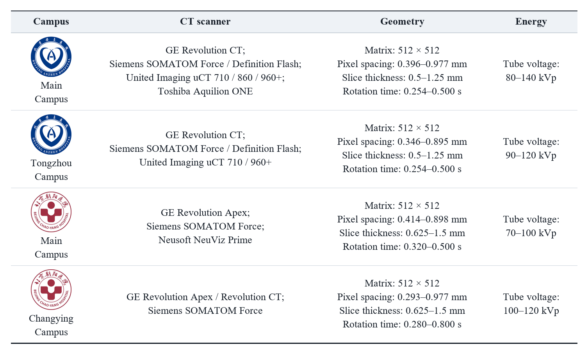
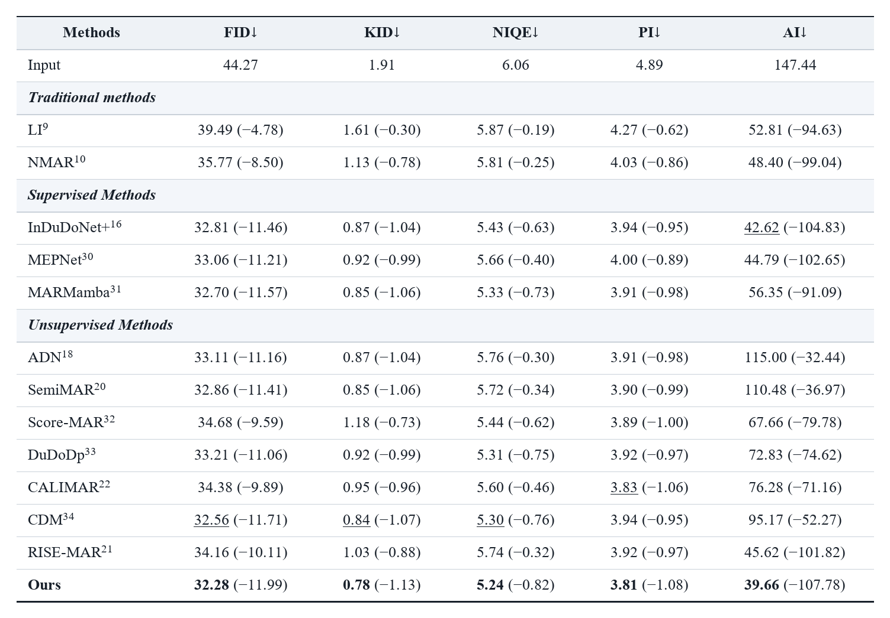
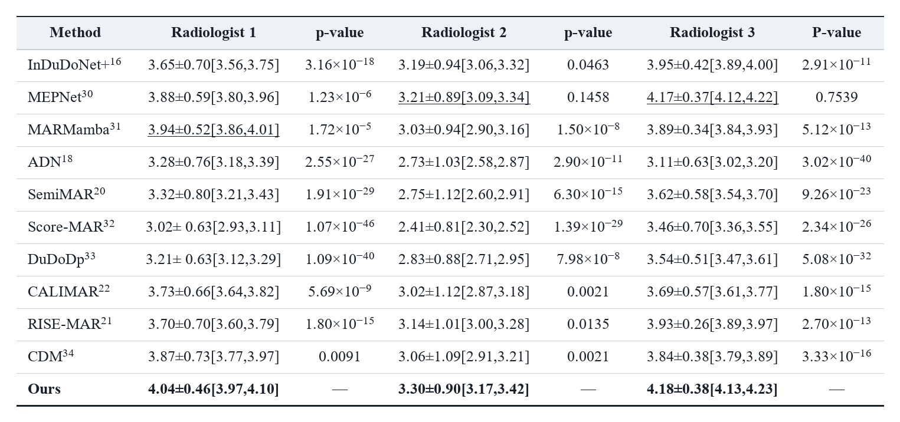
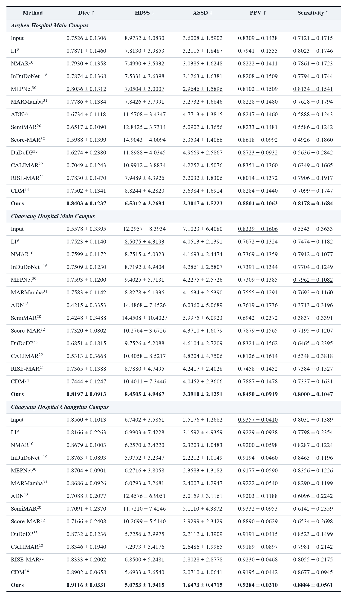
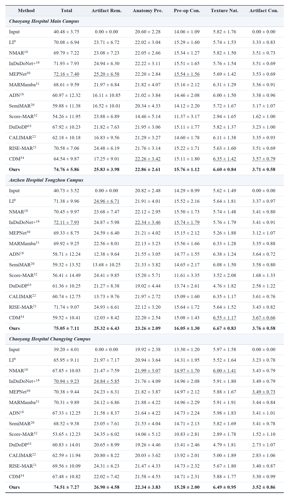
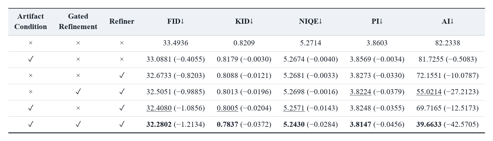

# 2SLRDM

Implementation of **Artifact Transfer and Latent Residual Diffusion for Metal Artifact Reduction in Aortic CT Angiography**.

2SLRDM reduces metal artifacts in aortic CT angiography (CTA) after coil embolization. It transfers residual artifacts from clinical scans to independently sampled images to construct pseudo-paired training data. A conditional 2.5D latent diffusion model estimates the correction, and a gated refiner updates the 512 × 512 image around the metal core. The pipeline starts from reconstructed images and computes its own linear interpolation (LI) reference.

## 1. Method Workflow

### Figure 1. Study design and evaluation workflow

Study design and evaluation workflow for metal artifact reduction after aortic coil embolization. (A) Data collection, model training, and image correction. (B) Training, internal testing, and external testing cohorts. (C) Clinical follow-up workflow. (D–F) Aortic segmentation, image quality assessment, and exploratory large language model–assisted evaluation.

[](imgs/figures/figure-01.png)

### Figure 2. Two-stage residual correction framework

A two-stage residual correction framework driven by real clinical artifacts. Clinical artifact residuals are transferred to independently sampled recipient images to construct pseudo-paired training samples. Conditional latent diffusion provides coarse correction through differential decoding, followed by gated residual refinement at full resolution. The framework preserves the preprocessed input values at every pixel within the metal core throughout both stages of correction.

[](imgs/figures/figure-02.png)

## 2. Code Tree

```text
2SLRDM/
├── configs/
│   └── default.yaml
├── imgs/
│   ├── figures/
│   └── tables/
├── marldm/
│   └── models/
├── precompute_li.py
├── train_vae.py
├── train_refiner.py
├── infer.py
├── infer_nii.py
└── requirements.txt
```

## 3. Datasets

The study used aortic CTA from four campuses of two hospitals. Anzhen Main Campus provided the training and internal testing cohorts. Chaoyang Main Campus, Anzhen Tongzhou Campus, and Chaoyang Changying Campus provided external testing cohorts. The training and internal test sets were split by patient.

The clinical datasets are subject to institutional access restrictions. The data availability statement in the manuscript describes the request process.

### Table 1. CT scanners and acquisition parameters

CT scanners and acquisition and image geometry parameters across four campuses. Parameter ranges reflect routine clinical examinations performed at each campus using its own CT acquisition protocols, without harmonization across the four participating campuses.

[](imgs/tables/table-01.png)

## 4. Environment

Use Python 3.10 or later and install a CUDA-enabled PyTorch build compatible with your GPU. The default LI backend uses ASTRA with CUDA support.

```bash
python -m pip install -r requirements.txt
```

Run the following commands from the repository root. In [configs/default.yaml](configs/default.yaml), set `data.with_metal`, `data.without_metal`, and `data.li_root` to your data directories. Organize training inputs as one folder per case, with one 2D NPY file per axial slice in Hounsfield units. Each LI file must match its metal-containing input's relative path and filename. Supply your checkpoints in the paths shown below.

## 5. Training

### Precompute the LI references

```bash
python precompute_li.py --config configs/default.yaml
```

### Train the LDM and Refiner

The default joint configuration freezes a pretrained VAE and runs latent diffusion at a 256 × 256 working resolution. The Refiner operates at 512 × 512.

```bash
python train_refiner.py --config configs/default.yaml --vae-checkpoint checkpoints/vae_best.pt
```

Add `--resume checkpoints/near_metal_dark_v1_last.pt` to resume a run with the matching VAE and configuration.

### Train a 512 × 512 VAE

For the 512 × 512 variant, train a VAE, then use its checkpoint for the joint training run.

```bash
python train_vae.py --config configs/default.yaml --batch-size 1
python train_refiner.py --config configs/default.yaml --coarse-size 512 --vae-checkpoint checkpoints/vae512_best.pt --output checkpoints/joint512_best.pt
```

## 6. Inference Steps

Use a matching VAE and joint checkpoint. If the checkpoints were trained with the 512 × 512 variant, also pass `--coarse-size 512`.

### Single NPY slice

```bash
python infer.py --config configs/default.yaml --input data/slice.npy --output outputs/mar.npy --vae-checkpoint checkpoints/vae_best.pt --checkpoint checkpoints/near_metal_dark_v1_best.pt
```

### Batch NPY inference

```bash
python infer.py --config configs/default.yaml --input data/with_metal --output outputs/mar --save-npy --vae-checkpoint checkpoints/vae_best.pt --checkpoint checkpoints/near_metal_dark_v1_best.pt
```

### NIfTI volume

```bash
python infer_nii.py --config configs/default.yaml --input data/volume.nii.gz --output outputs/mar.nii.gz --vae-checkpoint checkpoints/vae_best.pt --checkpoint checkpoints/near_metal_dark_v1_best.pt
```

## 7. Experimental Results

### Table 2. Image quality across MAR methods

Image quality comparison across methods on 2,630 CT slices with metal artifacts. Lower values indicate better performance for all metrics. Parentheses show changes relative to the original input. Bold and underlined values denote the best and second-best results for each metric.

[](imgs/tables/table-02.png)

### Figure 3. Visual comparison across artifact severity levels

Representative metal artifact reduction results across artifact severity levels. (a–c) Cases with high, medium, and low severity artifacts, showing original postoperative images, preoperative images, and results from each method. Cyan boxes mark magnified regions, and red overlays indicate metal regions.

[](imgs/figures/figure-03.png)

### Table 3. Radiologist ratings at Anzhen Main Campus

Radiologist ratings of image quality at Anzhen Main Campus. Values are mean ± SD [95% CI] for 200 slices (5-point Likert scale; higher is better). P-values compare each method with Ours using two-sided paired Wilcoxon signed-rank tests with Holm correction. Bold and underlined values denote the highest and second-highest mean scores in each column.

[](imgs/tables/table-03.png)

### Figure 4. Aortic segmentation and 3D reconstructions

Representative automatic aortic segmentations and three-dimensional reconstructions before and after metal artifact reduction. (a–c) Cases from Anzhen Main Campus, Chaoyang Main Campus, and Chaoyang Changying Campus, respectively, showing preoperative references and segmentations from original and corrected postoperative images, with magnified regions near metal.

[](imgs/figures/figure-04.png)

### Table 4. Agreement with preoperative aortic segmentations

Agreement of automatic aortic segmentations with registered preoperative references. Cohorts comprise 4, 4, and 5 CT volumes from Anzhen Main Campus, Chaoyang Main Campus, and Chaoyang Changying Campus, respectively. Bold and underlined values denote the best and second-best results for each metric within each cohort.

[](imgs/tables/table-04.png)

### Figure 5. Aortic segmentation metrics across cohorts

Comparison of aortic segmentation metrics across three cohorts and their cross-cohort average. Columns show Anzhen Main Campus, Chaoyang Main Campus, Chaoyang Changying Campus, and the cross-cohort average. Panels (a–d) compare the input, conventional methods, supervised methods, and the proposed method; panels (e–h) show the input, remaining comparators, and the proposed method.

[](imgs/figures/figure-05.png)

### Table 5. Exploratory LLM-assisted image quality scores

Exploratory LLM-assisted image quality scores across three external cohorts. Each cohort includes 200 slices. Higher scores indicate better ratings. Bold and underlined values denote the highest and second-highest mean scores for each metric within each cohort.

[](imgs/tables/table-05.png)

### Figure 6. Distributions of exploratory LLM-assisted scores

Distributions of exploratory large language model–assisted scores across three external cohorts. Panels (a–f), (g–l), and (m–r) show Chaoyang Main Campus, Anzhen Tongzhou Campus, and Chaoyang Changying Campus, respectively, with 200 slices per cohort. The proposed method is compared with the six comparators with the highest cross-cohort mean total scores. Higher scores indicate better ratings. \*\*\* denotes statistical significance compared with our model (p < 0.001).

[](imgs/figures/figure-06.png)

### Table 6. Component ablation

Ablation analysis of artifact conditioning, gated refinement, and the full-resolution refiner. ✓ and × indicate enabled and disabled components. Parentheses show changes relative to the baseline with all three components disabled. Bold and underlined values denote the best and second-best results for each metric.

[](imgs/tables/table-06.png)
